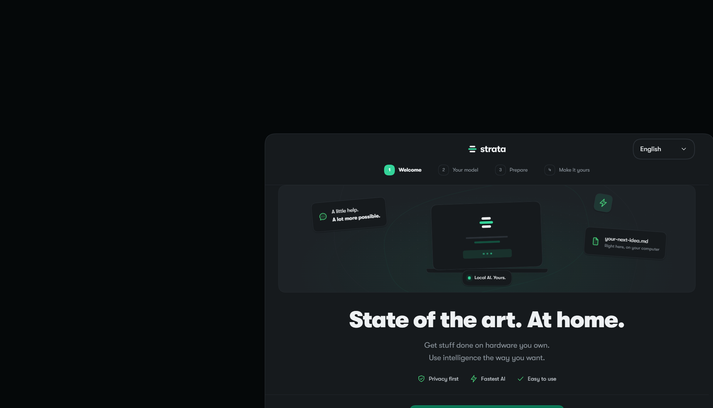
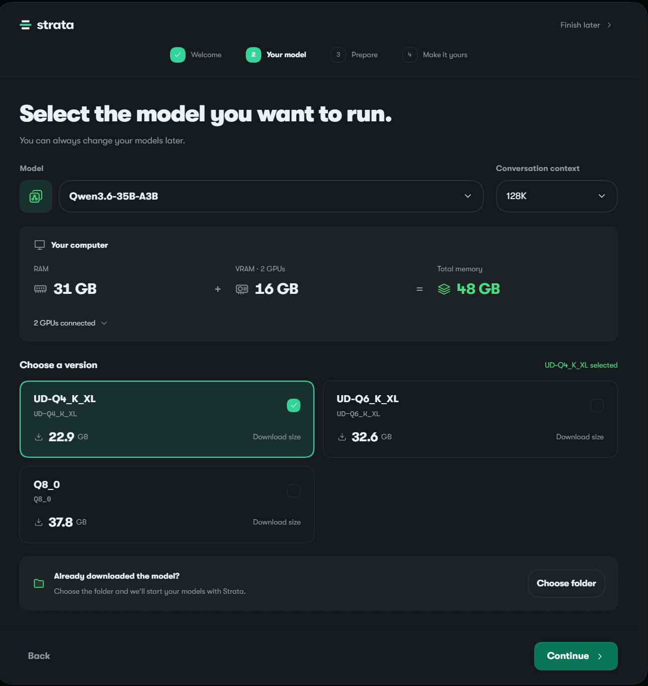
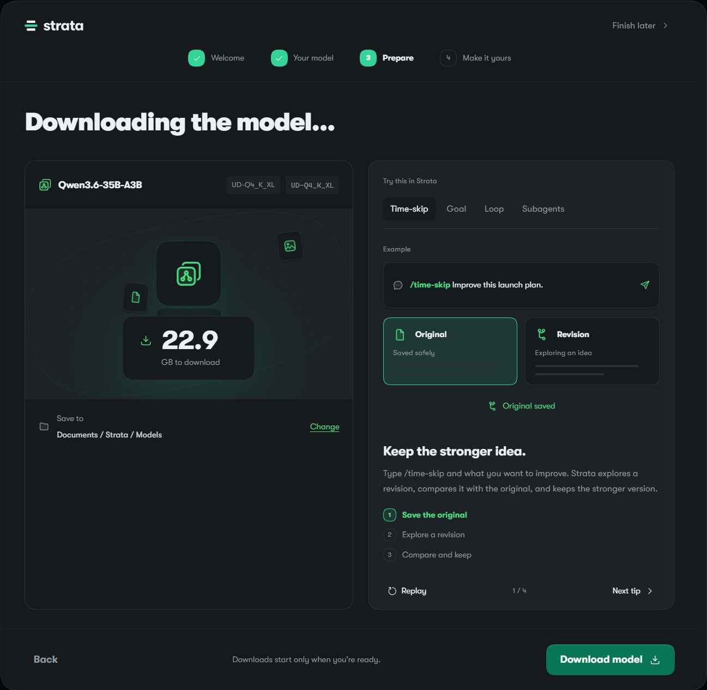
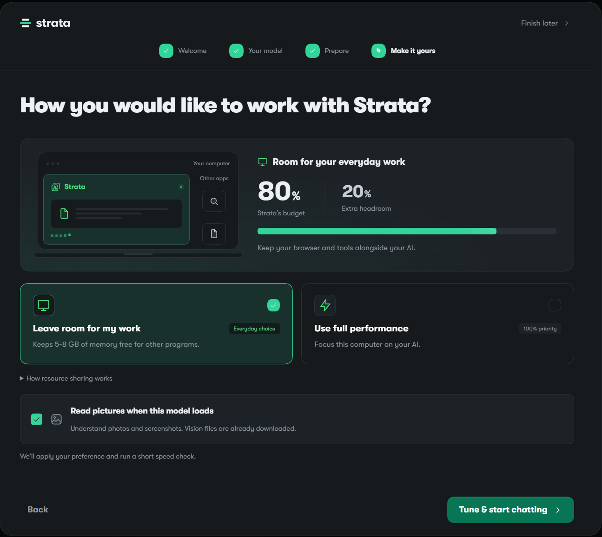
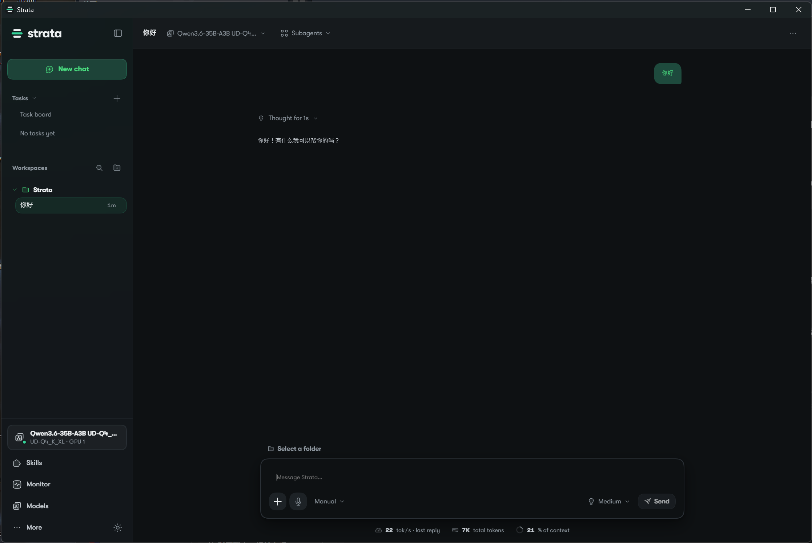

# Strata 本地部署實測紀錄

> 這份是實際在自己電腦上部署的紀錄，可搭配 `out/shots/` 的截圖閱讀。

## 一、測試環境

| 項目 | 規格 |
|---|---|
| 作業系統 | Windows 11 企業版 26200 |
| CPU | AMD Ryzen 7 9800X3D（8 核） |
| GPU | NVIDIA GeForce RTX 5070 Ti（16 GB VRAM） |
| RAM | 32 GB |
| 可用磁碟 | 188 GB |
| Strata 版本 | 0.2.15（Terminal / Control 0.1.61，引擎 0.1.60 CUDA 13） |

## 二、部署流程與截圖

### 1. 安裝與首次啟動

下載桌面版 `Strata-0.2.15-windows-x64-setup.exe` 安裝後開啟，進入四步驟精靈：Welcome → Your model → Prepare → Make it yours。



### 2. 選擇模型

App 偵測到 31 GB RAM + 16 GB VRAM（合計 48 GB），自動推薦 **Qwen3.6-35B-A3B**，並預選 **UD-Q4_K_XL（22.9 GB）**。



選擇理由：這是官方文件裡體積最小、且能在 32 GB RAM 機器上跑起來的版本。其他兩個版本（UD-Q6_K_XL 32.6 GB、Q8_0 37.8 GB）需要 44 GB 以上 RAM，這台跑不動。

### 3. 下載模型

下載 22.9 GB，存放於 `Documents\Strata\Models`。



### 4. 資源分配

選擇「Leave room for my work」，保留 5–8 GB 給系統與其他程式，其餘給模型；同時開啟圖片讀取。



## 三、遇到的問題與解法

### 第一次啟動失敗：VRAM 不足

錯誤訊息：

```
server_exited (exit code 1): EngineDied: the engine exited before it was ready
```

引擎日誌的關鍵行：

```
strata-q36: context 131072 cells, prompt chunk 2048, MTP block loaded, 0.00 GiB of VRAM free
strata-q36: not enough VRAM left for the hybrid experts' buffers and slots
            (1256 MiB needed, 0 MiB free after the weights, the context and the sessions):
            use fewer slots ("parallel" / --batch), a shorter --max-context
```

**原因**：預設 context 是 131072（128K）。模型權重只佔 4.40 GiB，但 128K 的 KV cache 把 16 GB 顯存幾乎吃光，最後只差 1256 MiB 就能啟動。

**解法**：把 `--max-context` 從 `131072` 改成 `32768`。修改檔案：

```
C:\Users\zdann\AppData\Local\Strata\install\strata-qwen36-ud-q4_k_xl.json
```

改完後重新啟動，日誌顯示：

```
strata-q36: context 32768 cells, prompt chunk 2048, MTP block loaded, 6.62 GiB of VRAM free
strata-q36: hybrid experts: 65 of 256 per layer in VRAM (4.76 GiB),
            all 18.75 GiB in pageable host memory,
            the rest of a batch of <= 128 rows on 8 CPU threads
```

這段正好印證了簡報講的「分層」：**256 個專家裡有 65 個放進顯卡（4.76 GiB），全部 18.75 GiB 放在系統記憶體，其餘由 8 條 CPU 執行緒分擔**。

## 四、實測數據

啟動耗時：

- 載入權重並分層：約 102 秒
- 暖機（一個 prompt chunk、一次解碼、一次投機解碼）：49.6 秒

推理速度（引擎日誌實測）：

| 情境 | 結果 |
|---|---|
| 短 prompt（11 tokens） | 讀取 38.8 tok/s |
| 24 tokens prompt，生成 200 tokens | 生成 24.7 tok/s |
| 7,001 tokens prompt，生成 38 tokens | 讀取 601.1 tok/s、生成 22.4 tok/s |

### 用 `speedtest.py` 做的標準測試

為了方便重複量測，我寫了一支小程式 `speedtest.py`，它會自動從 Strata 設定檔讀出 API 位址與金鑰，呼叫本機的 OpenAI 相容端點，並直接讀取引擎回報的 `timings`（不是自己估算）。每次測試跑 3 輪取中位數，預設關閉思考模式以確保結果可比。

執行：

```bash
python speedtest.py          # 標準測試
python speedtest.py --long   # 加測 8K 長 prompt
python speedtest.py --think  # 保留思考模式
```

結果（RTX 5070 Ti 16GB + 32GB RAM，Qwen3.6-35B-A3B UD-Q4_K_XL，context 32K）：

| 測試項目 | prompt tokens | 讀取 tok/s | 生成 tok/s | 耗時 s |
|---|---:|---:|---:|---:|
| 短問答 | 22 | 142.1 | 25.6 | 1.96 |
| 中文生成（約 250 字） | 36 | 190.2 | 24.9 | 8.14 |
| 中長 prompt（約 2K tokens） | 2,332 | 538.8 | 22.3 | 5.45 |

觀察：

- **生成速度穩定在 22–26 tok/s**，大約每秒 17–20 個中文字。
- **prompt 越長，讀取速度越快**（142 → 190 → 539 tok/s），因為批次處理效率提高。
- 2K prompt 的整體延遲只有 5.45 秒，其中大部分時間花在讀取（約 4.3 秒），生成只佔 1 秒多。
- 完整結果存在 `out/bench_result.json`，可直接當作報告附錄。

介面右下角顯示：**22 tok/s last reply**、76 total tokens、21% of context（7,001 / 32,768 ≈ 21%）。

## 五、第一次對話

問「你好」，模型以繁體中文回覆「你好！有什麼我可以幫你的嗎？」，確認模型正常運作。



## 六、結論與心得

1. **低硬體跑大模型是真的**：16 GB 顯卡的遊戲機跑得動 35B 的 MoE 模型，靠的是把專家分層放在 VRAM / RAM / CPU，而不是全部塞進顯卡。
2. **context 是隱形殺手**：真正卡住的不是模型大小，而是 KV cache。128K 直接爆掉，32K 就順了。這是官方文件沒特別強調、但實際部署一定會踩的坑。
3. **速度可接受**：22–25 tok/s 大約是每秒 17–19 個中文字，日常問答夠用，長文生成會慢一些。
4. **代價**：啟動要等 2–3 分鐘（載入 + 暖機），而且只支援特定模型家族；要跑其他模型還是得回到 Ollama。
