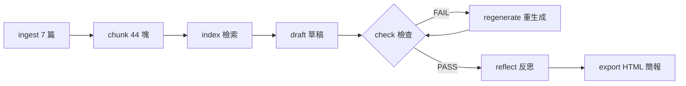

# 第十週作業繳交：LLM Wiki 教學 HTML 簡報

以下六項可直接複製到 NTU COOL 的線上輸入欄。

---

## 一、LLM Wiki 主題與簡短介紹

**主題：如何用 Strata 部署本地模型**

Strata 是類似 Ollama 的本地模型運行工具，主打在消費級硬體（12–24G 顯卡 + 32–64G 記憶體）上跑大型 MoE 模型，並在本機提供 OpenAI／Anthropic 相容 API。它開源、免帳號，可掛給 Claude Code、Codex CLI 等工具當後端。

我做的事情是：先將 7 篇資料（官方 README 拆分 4 篇、官方工作原理與效能實測 1 篇、自行整理的教學大綱 1 篇，以及新增的「為什麼要本地部署」1 篇）放進 `sources/`，建立自己的 LLM Wiki，再用這個 Wiki 產出一份 24 頁的教學型 HTML 簡報，內容涵蓋本地部署動機（含資料風險舉例與 API 定價）、硬體選型、量化選擇、安裝啟動、API 串接與限制取捨。來源均為官方文件與官方定價頁，並附上官方示意圖與社群實測數據。

---

## 二、LLM Wiki 連結或成果

- **本機成果**：`week10_hw/wiki/`
- **GitHub**：https://github.com/TW-Aki/TAICA_week10_hw

| 成果 | 內容 | 檔案 |
|---|---|---|
| 來源文件 | 7 篇（附標題／來源網址／日期／資料類型） | `sources/01`～`07_*.md` |
| 切塊 | 44 個 txt，每檔含 metadata 與 `【內容】` | `wiki/chunks/*.txt` |
| 清單 | chunk 與來源對照 | `wiki/manifest.csv` |
| Wiki 條目 | 6 個條目，每個有定義、重點、來源、關聯 | `wiki/entries/*.md` |
| 結構化資料 | 供簡報產生器讀取 | `wiki/entries.json` |
| 建立腳本 | ingest → chunk → index → draft → check → regenerate → reflect | `llm_wiki.py` |

---

## 三、教學 HTML 簡報連結

- **線上直接開（推薦）**：https://htmlpreview.github.io/?https://github.com/TW-Aki/TAICA_week10_hw/blob/main/out/strata_deployment_teaching.html
- **檔案**：`week10_hw/out/strata_deployment_teaching.html`
- **開啟方式**：點上面連結直接在瀏覽器渲染；或下載檔案用瀏覽器開啟（單檔，不依賴外部 CDN）
- **操作**：← → 或空白鍵翻頁
- **頁數**：24 頁

> 註：GitHub 對 `.html` 檔預設顯示原始碼，直接用 repo 裡的檔案連結會看到程式碼；上面的 htmlpreview 連結才會渲染成簡報。

章節：章節：封面 → **目錄（五段結構）** → 為什麼本地部署（隱私）→ API token 成本 → Strata 是什麼 → **為什麼用 Strata（低硬體跑大模型）** → 官方原理圖 → **Ollama/Strata 逐項對比** → 三種情境怎麼選 → 硬體與量化 → 三條安裝路線 → 第一次啟動 → **我的實際部署（含截圖）** → **實機展示（對話畫面與輸出）** → API 串接 → 官方社群實測 → 我的實測 → 與官方數字對照 → 限制 → Wiki 如何產生簡報 → Graph 設計圖 → Loop 執行紀錄 → 反思 → 總結。

---

## 四、loop / graph 的流程圖或文字說明



| 節點 | 職責 |
|---|---|
| `ingest` | 讀 7 篇來源，檢查是否至少 5 篇 |
| `chunk` | 依標題切小節，再切 700 字區塊 |
| `index` | 字元 bigram + TF-IDF Lite |
| `draft` | 檢索 context 後請 LLM 產生結構化條目 |
| `check` | 驗證 5 個欄位（title／definition／bullets／sources／related） |
| `regenerate` | 只補缺失欄位後回到 check（重複節點） |
| `reflect` | 統計輪數與通過率，寫出錯誤節點與調整 |
| `export` | 輸出條目並交給 `build_slides.py` 產生 HTML |

關鍵設計：**check 與 regenerate 構成可重複的迴圈**，最多 3 輪；通過後才進入反思與輸出。流程圖也畫在簡報第 11 頁。

---

## 五、一次實際執行的結果或檢查紀錄

節錄 `out/run_log.md`（完整檔在專案內）：

```
[node:ingest] 讀取來源文件
  共 ingest 7 篇：01_strata_overview, 02_install_guide,
  03_model_and_memory, 04_api_connect, 05_compare_tools, 06_teaching_outline

[node:chunk] 切塊
  產生 44 個 chunk -> wiki/chunks/、wiki/manifest.csv

[node:index] 建立索引
  索引 44 個 chunk

[node:draft] 主題：常見問題與效能瓶頸
  檢索命中：03_model_and_memory_002(37.75),
            03_model_and_memory_004(28.06),
            05_compare_tools_007(25.514), ...
[node:check] 第 1 輪
  FAIL -> 缺少：「sources, related」
[node:regenerate] 補齊 sources, related 後回到 check
[node:check] 第 2 輪
  PASS -> 接受條目

[node:reflect] 反思
  -> out/reflection.md

[node:export] 完成
  wiki/entries/ (6 個條目)
```

統計：7 篇來源 → 44 個 chunk → 6 個條目 → 累計 7 輪檢查 → 6 個條目全數通過（其中 1 個走了 2 輪）。

### 個人複查

繳交前我自己做了三項複查：

**1. 修正簡體字**
用 `zhconv` 掃描全專案（`sources/`、`wiki/`、`out/`、`*.md`、`*.py`），把「複雜」「檢索」「顯存」「報錯」「並發」等詞被誤打成簡體的狀況逐一修正，最後掃描結果為 **0 個簡體殘留**。另外刻意保留「平台」「下游」這種在繁體也通用的詞，避免改出奇怪用法。

**2. 確認資料可靠性**
- 來源全部換成官方文件：官方 README、`docs/HOW_IT_WORKS.md`、`docs/MODELS.md`、`docs/COMMUNITY_BENCHMARKS.md`，移除原本的第三方評論。
- 每個數字都對回官方原文，並在簡報註明「社群實測、非保證值」。
- 用實際部署驗證：跑出 22–26 tok/s，與官方 48.2 有落差，追查後確認是模型不同（35B vs 125B）與專家分配（65/256 在顯卡）造成，而不是數據造假。
- 官方兩筆同為 48.2 tok/s 的紀錄，確認是不同報告的巧合，已在簡報加註。

**3. 確認簡報正常發佈**
- 檔案：`out/strata_deployment_teaching.html`，單檔 24 頁、4 張圖以 base64 內嵌，不依賴外部資源。
- 線上：GitHub `main` 分支 + `gh-pages` 分支都已推送；用 htmlpreview 連結實際開啟，確認可正常渲染、方向鍵可翻頁。
- 驗證頁數、圖片數量、來源篇數（7）、chunk 數（44）與實際檔案一致。

---

## 六、反思：哪個節點最常出錯？你如何調整檢查流程？

**最常出錯的不是程式節點，而是 `ingest` 進來的資料本身。** 實際遇到三種狀況：

1. **過時**——部落格寫的是 0.1.x 版，官方早已更新到 0.2.15，指令與數字都對不上。
2. **不夠權威**——媒體說「比 llama.cpp 快 6 倍」，社群實測只有約 2 倍；行銷數字不能直接引用。
3. **與實機不符**——官方說 12–24G 顯卡可跑，但 128K context 在 16GB 機器上直接爆顯存，必須降到 32K。

`check` 節點只能驗證格式（有沒有來源、字數夠不夠），**驗不出資料真假**，所以真正要加強的是「來源」與「驗證」兩層。

**我怎麼調整檢查流程**：

1. 來源分級：官方文件 > 官方 benchmark > 社群回報 > 媒體評論，最後只留官方。
2. 每篇補 metadata（來源網址、整理日期、資料類型），讓過時可以被發現。
3. 同一數字至少兩個來源；衝突時標註，不二選一。
4. **實際操作驗證**：用 `speedtest.py` 跑出 22–26 tok/s，與官方 48.2 對不上，追查後發現是模型不同（35B vs 125B）、且只有 65/256 個專家在顯卡。
5. 把驗證結果寫回 Wiki：新增「為什麼要本地」一篇，並把原本的第三方評論換成官方 `HOW_IT_WORKS.md`。

**收穫**：程式節點的錯誤，validator 抓得到；資料的錯誤，只有實際跑一次才會露出來。Wiki 的品質上限，取決於你餵給它的來源。
